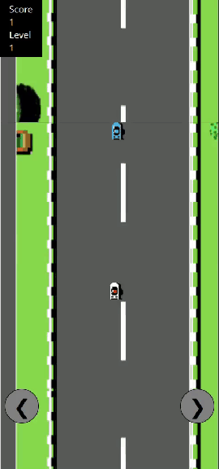

# Road Fighter — QML port

This is a port of my [Road-Fighter-Compose](https://github.com/kaiwalyakhasnis/Road-Fighter-Compose)
project, entirely done by Muse AI. It rebuilds the Jetpack Compose game in Qt Quick (QML),
so it runs natively on Ubuntu/desktop Linux.

<p align="center">
  
</p>

<p align="center"><a href="docs/demo.mp4">Watch the full-quality video (MP4)</a></p>

Same mechanics as the original:

- The road scrolls one full screen per level "speed" (1500 ms at level 1 down to 750 ms at level 6).
- The blue car rides the same loop and re-enters at a random x each pass.
- Steer the red player car with the **left/right arrow keys** or the on-screen buttons — 20 px per press, like the original.
- Touching the grass or the blue car ends the game. Tap / press **R** or **Space** to restart.
- Passing the blue car scores 1 point; every 25 points raises the level (faster scroll, side strips tinted blue / light red on some levels).
- Car sprites are drawn from the original Android vector-drawable path data (`Car.qml`); the road uses the original PNG strips.

## Run on Ubuntu

```sh
sudo apt install qt6-base-dev qt6-declarative-dev cmake g++ \
                 qml6-module-qtquick qml6-module-qtquick-window qml6-module-qtqml
cmake -S . -B build
cmake --build build
./build/roadfighter-qml
```

Or without CMake, using the bundled qrc:

```sh
/usr/lib/qt6/libexec/rcc -name resources resources.qrc -o resources.cpp
g++ -fPIC -std=c++17 main.cpp resources.cpp -o roadfighter-qml \
    $(pkg-config --cflags --libs Qt6Core Qt6Gui Qt6Qml Qt6Quick)
./roadfighter-qml
```

## Demo mode

`./roadfighter-qml --demo` enables an autopilot that steers the car and
auto-restarts after a crash — used to record the preview video hands-free.
